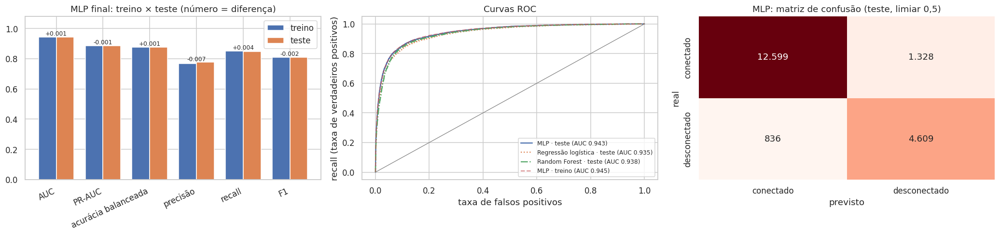

# Relatório de IA & ML: Me Conta

**Quais idosos têm mais chance de estar desconectados da internet?**
Global Solution 2026.2 · CitizenTech · Nicoli Amy Kassa | RM559104
Notebook: `GS2026_IA_ML_MeConta.ipynb` · Vídeo (YouTube, não listado): `[inserir link]`

## 1. Pergunta e dados

O Me Conta troca o 👍 da família por uma pergunta que só a avó sabe responder. Para quem ainda está fora da internet,
existe o degrau **Conectar** ("Ensine sua avó"). Pergunta de ML (classificação binária): **dado o perfil de uma pessoa de
60+, qual a chance de ela não ter usado a internet nos últimos três meses?**

Base: **PNAD Contínua 2025, 4º trimestre, módulo TIC (IBGE)**, com 96.531 pessoas de 60+ em 71.022 domicílios. Com o
peso `V1028`, **25,5% (9,1 milhões)** estão desconectados, o complemento dos 74,5% de usuários da
[divulgação do IBGE](https://agenciadenoticias.ibge.gov.br/pt/agencia-noticias/47408-proporcao-de-usuarios-da-internet-no-pais-ultrapassou-90-da-populacao-de-10-anos-ou-mais-em-2025.html).
Dois em cada três dizem que não sabiam usar, mas em 52% dos casos quem respondeu foi outra pessoa.

## 2. Preparação

21 variáveis (idade, escolaridade, renda, território, celular próprio e **outros** moradores da casa). Ficaram de fora as
perguntas feitas só a usuários ou só a não usuários, `S07007` e `S01029`, que quase repetem o alvo. Divisão 80/20
estratificada e **por domicílio** (77.159 / 19.372). Pré-processamento ajustado só no treino. Desbalanceamento (2,62
conectados por desconectado) tratado com `pos_weight` e escolha pela AUC. Treino sem peso; métricas do teste também
ponderadas, para falar da população.

## 3. Modelo e busca

**MLP em PyTorch** (`Linear → ReLU → Dropout`, 1 logit, `BCEWithLogitsLoss`, Adam, batch 256). Grade de **12
combinações**: arquitetura (32 · 64×32 · 128×64×32) × learning rate (0,01 · 0,001) × dropout (0 · 0,3), com validação
cruzada de 5 folds só no treino, até 30 épocas. Escolha pela **regra de 1 erro-padrão** (EP = DP / √5): **9 de 12
combinações empatam** com a melhor, e fica a mais simples.

| Validação cruzada (AUC) | Época 30 | Melhor época | Gap época 30 | Gap melhor época |
|---|---|---|---|---|
| Só `tem_celular` | 0,8133 | — | 0,0000 | — |
| Logística com 5 variáveis | 0,9243 | — | 0,0000 | — |
| Regressão logística | 0,9335 | — | 0,0005 | — |
| Random Forest | 0,9335 | — | 0,0130 | — |
| MLP 64×32, lr 0,001, drop 0,3 (maior AUC) | 0,9406 | 0,9408 (ép. 20) | 0,0086 | 0,0065 |
| **MLP 32, lr 0,001, drop 0,3 (escolhida)** | 0,9403 | 0,9403 (ép. 30) | **0,0032** | **0,0032** |
| MLP 128×64×32, lr 0,01, sem dropout | 0,9252 | 0,9398 (ép. 5) | 0,0435 | 0,0067 |

* **Contexto da AUC:** só saber se a pessoa tem celular já dá 0,813, e uma logística com 5 variáveis chega a 0,924. A
  MLP escolhida supera a logística completa por **0,0071 ± 0,0010** de AUC fold a fold, à frente nos 5 folds.
* **Épocas:** a melhor época da escolhida era a última. Estendida até 60, a melhor passou a ser a 58, com ganho de só
  0,0003 (0,9403 → 0,9406), menor que 1 EP: a curva está num platô. O modelo final usa 58 épocas.
* **Overfitting:** a curva em "U" aparece com lr 0,01 e nas redes de 3 camadas; a pior cai de 0,940 (época 5) para
  0,925 (época 30). O dropout melhora a AUC nos 6 pares na época 30, mas só em 3 de 6 na melhor época: com uma semente
  por fold, o efeito dele depende de quando o treino para.
* **O que a MLP aproveita a mais:** dando interações à logística, a que mais a aproxima da MLP é **conexão da casa ×
  perfil** (16% da vantagem); com todas as testadas, só 24%. Nenhum par explica sozinho a vantagem da rede.

## 4. Resultados no teste

Configuração e épocas definidas na validação; treino completo; teste avaliado uma única vez. Números obtidos no Google
Colab com GPU T4.

| | AUC | PR-AUC | Recall | Precisão | F1 |
|---|---|---|---|---|---|
| MLP · treino | 0,945 | 0,886 | 85,1% | 77,0% | 0,808 |
| **MLP · teste** | **0,943** | **0,887** | **84,6%** | **77,6%** | **0,810** |
| MLP · teste ponderado | 0,942 | 0,873 | 83,0% | 76,3% | 0,795 |
| Regressão logística · teste | 0,935 | 0,872 | 83,5% | 76,1% | 0,796 |
| Random Forest · teste | 0,938 | 0,871 | 85,3% | 75,6% | 0,802 |

* **Na população:** o modelo encontra 83% dos idosos desconectados, e 76% dos que ele aponta estão de fato
  desconectados. Na amostra de teste, são 4.609 de 5.445 encontrados, com 1.328 alarmes falsos.
* **Overfitting:** quase nenhum (AUC 0,945 × 0,943; gap de 0,0014).
* **Incerteza (bootstrap por domicílio, 1.000 reamostragens):** a diferença de AUC MLP − logística é de **0,0081 (IC 95%:
  0,0068 a 0,0095)**. Pequena, mas não é acaso.
* **Município de São Paulo** (349 idosos no teste): AUC 0,931 (IC 0,893 a 0,965), recall ponderado 81,0% (70,7% a
  90,0%) e precisão ponderada 66,6% (55,3% a 77,2%). Serve como indicação para o piloto.

## 5. O que o modelo aprendeu

| Retirar e retreinar (teste) | AUC | Recall com a mesma precisão (77,6%) |
|---|---|---|
| Modelo completo | 0,943 | 84,6% |
| Sem `tem_celular` | **0,883** | **54,4%** |
| Sem `outros_usam_internet` | 0,917 | 77,7% |
| Sem o bloco do domicílio | 0,911 | 76,8% |

O **celular próprio** é o que mais pesa. A permutação individual exagera `outros_usam_internet` (0,226), porque cria
casas impossíveis; embaralhado em bloco, o domicílio cai para 0,066, atrás do celular (0,170). Essa variável funciona
quase como "a casa tem internet": 98,5% dos idosos com outro morador conectado vivem em casa com internet. Importância
não tem sinal nem indica causa.

## 6. Conclusão: dois públicos

Os 9,1 milhões de idosos desconectados não precisam da mesma coisa:

* **Sem acesso:** **5,9 milhões (65%)** não têm celular próprio e **1,4 milhão (16%)** têm celular sem internet. O
  primeiro passo é o aparelho ou o plano, por **parceria ou doação** (programas de inclusão digital, operadoras,
  prefeitura). Ensinar não resolve sem acesso.
* **Com acesso e sem uso:** **1,8 milhão (19%)** já têm celular com internet e não usam. Esse é o público do **"Ensine sua
  avó"**. Nesse grupo, o modelo põe no topo os idosos de **75+ com pouca escolaridade**: entre os de 80+ com até 3 anos
  de estudo, 23% estão desconectados (teste, sem peso; n = 309), contra 6,6% de todos os idosos com celular com internet
  (ponderado).

**Ter alguém conectado em casa não basta:** 4,9 milhões de desconectados moram com alguém que usa a internet. O Me Conta
parte da hipótese de que falta quem pare para ensinar e um motivo para usar: a pergunta da família. Só a capital
paulista, onde fica o piloto, tem 440 mil idosos desconectados.

**Limitações:** correlação, não causa; um único ano; informante substituto em metade dos desconectados; risco previsto
acima da probabilidade real por causa do `pos_weight` (serve para ordenar, não como probabilidade); uma semente por fold.
O modelo serve para priorizar ações, nunca para rotular uma pessoa.

**Reprodução:** na pasta `ml/`, instale `requirements.txt`, gere a base com `python dados/extrair_pnadc.py` (veja
`dados/README.md`) e execute o notebook do início ao fim, com `QUICK = False`.
